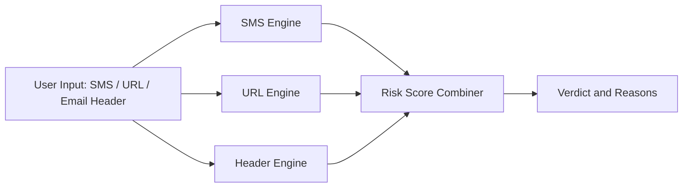

# Scamoflage

**Phishing and Scam Detection for India**
GRAVITON 2026, CGC University, Mohali | Problem Statement 02

## Problem

Phishing and social-engineering scams are a growing threat in India. Fraudsters
impersonate banks, government bodies, and delivery services through fake KYC
alerts, UPI warnings, courier fees, and "digital arrest" threats. These messages
are written in English, Hinglish, and Romanized Punjabi, and generic spam
filters are not designed to catch them.

## Solution

Scamoflage analyzes three types of input, namely SMS messages, URLs, and email
headers, and combines the results into a single risk score with a clear,
human-readable explanation of why the input was flagged.

## Architecture



| Engine | Signals analyzed |
|---|---|
| SMS Engine | Urgency language, KYC and bank impersonation, Hinglish and Punjabi scam patterns |
| URL Engine | Lookalike domains, mismatch against a verified list of Indian brand domains |
| Header Engine | SPF, DKIM and DMARC results, Reply-To mismatch, display-name spoofing |

## Repository Structure

```
backend/data/brands.json     Verified Indian brand domains
data/sms/                    Scam and legitimate SMS samples (redacted)
data/urls/                   Phishing and legitimate URL samples
data/headers/                Email header samples and expected.csv
docs/demo-script.md          Three-minute demo script
docs/limitations.md          Known limitations
```

## Setup

1. Clone the repository: `git clone [repository URL]`
2. Move into the backend folder: `cd backend`
3. Install dependencies: `pip install -r requirements.txt`
4. Start the application: `[run command]`

## Data Handling

- All personal information (names, phone numbers, email addresses, OTPs,
  account numbers) has been redacted.
- All phishing links are defanged (for example, `hxxp://example[.]xyz`) and
  must never be opened in a browser.
- Synthetic samples are clearly labelled in the `source` column of the datasets.

## Team

[Team Lead], [Teammate 1], [Teammate 2], [Your Name]

## Limitations

See [docs/limitations.md](docs/limitations.md).